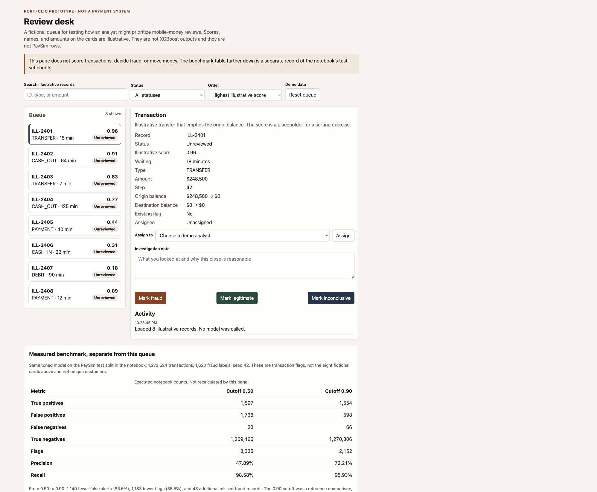

# Mobile-money fraud review: an XGBoost benchmark and a queue prototype

How could a mobile money risk team prioritize transaction reviews while maintaining an acceptable level of fraud coverage?

This repository compares two fixed cutoffs on one tuned XGBoost model, trained on the synthetic PaySim log, and separates that benchmark from a clickable analyst queue. The model is a reproduction of a published workflow. It is not a launch candidate. The recommendation is to validate and rebuild the model’s inputs before a pilot, and to use the prototype to test the review workflow in the meantime.

## Role and status

Nelson Kilima. Independent portfolio study for product management roles in payments, fintech, and machine learning.

The benchmark reproduction and the prototype are in this repository. Implementation was AI-assisted. Customer discovery, production deployment, prevented fraud, and financial savings have not been demonstrated. No code license has been chosen; that remains an owner decision before anyone else is granted rights to reuse the code.

## Where to go next

- [Product case study](docs/case-study.md) — the decision, the trade-off, and what is still unvalidated
- [Notebook](XGBoost_Fraud_Detection.ipynb) — the only training and evaluation implementation
- [Review-desk prototype](prototype/index.html) — fictional queue, opened in a browser
- [Technical report](docs/technical-report.md) — data, split, model, and limits
- [Discovery plan](docs/discovery-plan.md) — sessions that have not been run
- [Model card](docs/model-card.md) — intended use and unsuitable uses

## Prototype



The cards in that screen are fictional. The table underneath them is the notebook’s test-set benchmark, kept in a separate panel.

## Decision and threshold trade-off

Rebuild the inputs before a pilot. In the executed run, gain importance concentrates on `newbalanceOrig`. The PaySim author warns against using the four balance fields for fraud detection, because detected fraudulent transactions are cancelled. This reproduction kept those fields, and preprocessing was fitted on the full dataset before the split.

While that rebuild is outstanding, the prototype makes a review workflow testable: search, status filters, score or waiting-time order, assignment, a required note, and fraud, legitimate, or inconclusive closes.

On the same tuned scores, moving the cutoff from 0.50 to 0.90 produced:

- 1,140 fewer false alerts, about 65.6 percent
- 1,183 fewer flags, about 35.5 percent
- 43 additional missed fraud records

Flags are transactions in the test split, not unique customers and not deduplicated investigations. The 0.90 cutoff matches the source article’s comparison point. It is not a business-optimized launch threshold, and the scores have not been validated as calibrated probabilities.

## Results

Executed notebook, seed 42. Full file: 6,362,620 rows, 8,213 fraud. Training: 5,090,096 rows. Test: 1,272,524 rows, of which 1,620 are fraud. Tuned model: depth 8, learning rate 0.1, 200 trees.

| Metric | Cutoff 0.50 | Cutoff 0.90 |
|---|---:|---:|
| True positives | 1,597 | 1,554 |
| False positives | 1,738 | 598 |
| False negatives | 23 | 66 |
| True negatives | 1,269,166 | 1,270,306 |
| Total flags | 3,335 | 2,152 |
| Precision | 47.89% | 72.21% |
| Recall | 98.58% | 95.93% |

These locally verified counts match the reference table for this study. The source article’s reported 74 percent precision and 96 percent recall at 0.9 are a comparison target, not this run. Detail and the baseline sit in [the technical report](docs/technical-report.md) and [results/metrics.csv](results/metrics.csv).

Accuracy is omitted as a headline. Always predicting legitimate is already 99.87 percent accurate on this file.

## Reproduce

Tested with Python 3.12.4.

1. Create a virtual environment and install the pinned packages.

```bash
python3.12 -m venv .venv
source .venv/bin/activate
python -m pip install -r requirements.txt
python -m ipykernel install --user --name fraud-detection --display-name "Python (fraud detection)"
```

2. Download the PaySim CSV and place it at `data/PS_20174392719_1491204439457_log.csv`. Steps and attribution are in [data/README.md](data/README.md). The file is gitignored.
3. Open `XGBoost_Fraud_Detection.ipynb`, select the environment above, and run all cells from the top. `CSV_PATH` is the only dataset path. Leave `SAMPLE_ROWS = None` and `RUN_PARAMETER_SEARCH = True` for a full run.
4. Read the saved outputs if you only need the recorded results. Re-running the search took about three minutes in the saved run and does not need to be repeated to read this repository.

To open the prototype, open `prototype/index.html` in a browser. It has no server and no model.

## Limitations and next steps

- The data are synthetic.
- Fraud labels in this file occur only in transfers (4,097) and cash-outs (4,116). That does not establish coverage of other fraud patterns.
- The reproduction retained `oldbalanceOrg`, `newbalanceOrig`, `oldbalanceDest`, and `newbalanceDest` despite the PaySim author’s warning.
- Preprocessing was fitted before the train/test split.
- The random split does not establish performance on later activity.
- The 0.90 cutoff is a reference comparison.
- Scores have not been validated as calibrated fraud probabilities.

Next, and not yet done: a valid-feature rebuild, a chronological evaluation, and the analyst sessions in the discovery plan.

## Sources

- Stuart Walker, [Fraud detection using XGBoost, a machine learning approach](https://www.linkedin.com/pulse/fraud-detection-using-xgboost-machine-learning-approach-stuart-walker-apeie/). Method benchmark. This notebook recomputes the metrics.
- Edgar Alonso Lopez-Rojas, Ahmad Elmir, and Stefan Axelsson, “PaySim: A financial mobile money simulator for fraud detection,” 28th European Modeling and Simulation Symposium, 2016.
- Dataset distribution: [ealaxi/paysim1 on Kaggle](https://www.kaggle.com/datasets/ealaxi/paysim1).
